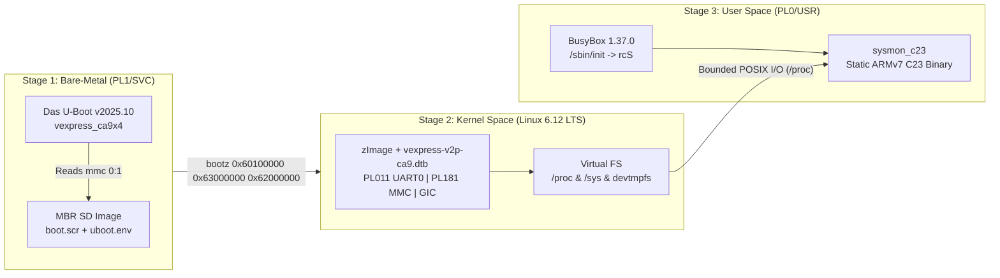

# ARMv7 Embedded Linux Bring-Up & C23 Telemetry Monitor

> End-to-end bare-metal-to-userspace Embedded Linux platform engineered from
> scratch for ARM Cortex-A9 (`vexpress-a9`), featuring a zero-heap,
> MISRA C:2025-aligned system monitor written in ISO C23.


[License](https://www.google.com/search?q=./LICENSE)

## Overview

Most Embedded Linux demos rely on pre-built distributions (Yocto/Buildroot
images or vendor BSPs) that abstract away the underlying boot mechanics. This
project constructs **all four foundational layers of an Embedded Linux system
manually** from upstream sources and packages them into a reproducible,
single-command QEMU lab (`make demo`):

1. **Cross-Compilation Toolchain:** `arm-linux-gnueabihf` (ARMv7 hard-float)
   with automated `C23` / `C2x` standard detection.

2. **Bootloader (`Das U-Boot v2025.10`):** Configured for `vexpress_ca9x4`
   with FAT-backed environment persistence (`uboot.env`) on an
   MBR-partitioned virtual SD card (`mmc 0:1`).

3. **Kernel & Device Tree (`Linux 6.12 LTS`):** Custom-configured `zImage`
   and `vexpress-v2p-ca9.dtb` supporting `devtmpfs`, `procfs`, `sysfs`, and
   compressed `initramfs`.

4. **RootFS & C23 Telemetry (`BusyBox 1.37.0` + `sysmon_c23`):** Static
   minimal userspace paired with a deterministic, overflow-safe telemetry
   monitor (`sysmon_c23`) audited with AddressSanitizer and UBSan.

## System Architecture

### Multi-Stage Boot & Telemetry Pipeline



### ARMv7 DRAM Memory Map (`vexpress-a9`)

To prevent payload overlap during U-Boot decompression and relocation
(`DRAM Bank 0` base `0x60000000`), images are staged at deterministic offsets:

| Component | U-Boot Variable | Address | Format / Purpose | 
| ----- | ----- | ----- | ----- | 
| **Boot Script** | *(Scratch Load)* | `0x60000000` | `boot.scr` (`mkimage`) | 
| **Linux Kernel** | `${kernel_addr_r}` | `0x60100000` | `zImage` (ARMv7) | 
| **Device Tree** | `${fdt_addr_r}` | `0x62000000` | `vexpress-v2p-ca9.dtb` | 
| **RootFS** | `${ramdisk_addr_r}` | `0x63000000` | `uInitramfs` (`cpio.gz`) | 

## Engineering Decisions & Problem Solving

* **Safety-Critical C23 (`<stdckdint.h>` & MISRA C:2025):** Eliminates silent
  integer wrap-around on 64-bit `/proc/stat` jiffies using `ckd_add()`,
  `ckd_sub()`, and `ckd_mul()`, `[[nodiscard]]`, `nullptr`, fixed-point
  *permille* (`1/1000`) math, and **100% stack allocation** (zero
  `malloc`/`free` in the sampling loop).

* **Rootless Disk Packaging (`sfdisk` + `mtools`):** Avoids `losetup`/`mount`
  failures in unprivileged containers and fixes the *superfloppy* error
  (`No partition table - mmc 0`) by writing a DOS/MBR partition table
  (bootable FAT32 LBA `0x0c`) and copying artifacts with `mcopy` using **zero
  `sudo` privileges**.

* **Upstream Cross-Build Fixes:** Disables x86 SHA-NI acceleration
  (`CONFIG_SHA1_HWACCEL=n`, `CONFIG_SHA256_HWACCEL=n`) and `CONFIG_TC` in
  BusyBox `1.37.0` to build cleanly on ARM against Linux `>= 6.8` headers,
  and dynamically resolves the Linux `>= 6.5` DTB path
  (`arch/arm/boot/dts/arm/`).

* **QEMU SMP Boot Separation:** Separates `make demo` (single-core U-Boot
  booting `boot.scr` from `mmc 0:1`) from `make direct` (4-core `-smp 4`
  direct `zImage` boot where QEMU parks secondary cores in `WFI`), avoiding
  multi-core stack corruption at `0x0`.

## Quick Start (One-Command Demo)

### Prerequisites

* **Host OS:** Ubuntu 22.04 / 24.04 LTS or Debian 12/13 (`x86_64`)

* **Tooling:** `arm-linux-gnueabihf-gcc`, `qemu-system-arm`, `u-boot-tools`,
  `dosfstools`, `mtools`, `fdisk` *(auto-installed by `make deps`)*

### Option 1: Automated Build & Boot (Recommended)

Clone the repository and run a single command to install dependencies, build
U-Boot, Linux 6.12 LTS, BusyBox, audit & cross-compile `sysmon_c23`, package
`sdcard.img`, and boot QEMU:

```
git clone https://github.com/USER/p02-armv7-embedded-linux-bringup.git
cd p02-armv7-embedded-linux-bringup
make demo

```

> **Tip:** To run a fast 4-core SMP direct-kernel boot (bypassing U-Boot)
> after building, run `make direct`.

### Option 2: Modular Stage-by-Stage Execution

```
./scripts/01_install_deps.sh    # Host toolchain, QEMU, mtools, sfdisk
./scripts/02_build_uboot.sh     # Das U-Boot v2025.10 (vexpress_ca9x4)
./scripts/03_build_kernel.sh    # Linux Kernel 6.12 LTS (zImage + DTB)
./scripts/04_build_busybox.sh   # Static BusyBox 1.37.0 + /etc/init.d/rcS
./scripts/05_build_sysmon.sh    # ASan/UBSan audit + ARMv7 C23 build
./scripts/06_package_images.sh  # uInitramfs, boot.scr & MBR sdcard.img
./scripts/07_run_qemu.sh        # Launch QEMU vexpress-a9

```

## Verification & Testing inside QEMU

Once U-Boot loads `boot.scr` and Linux drops into the interactive BusyBox
shell (`/ #`), run the following checks:

1. **Verify Kernel, Architecture & Device Tree Model:**

   ```
   uname -a
   cat /proc/device-tree/model && echo ""
   
   ```

2. **Run the C23 Telemetry Monitor (5 samples, 1000 ms interval):**

   ```
   sysmon_c23 5 1000
   
   ```

   **Expected Output:**

   ```
   ============================================================
    Embedded Linux Portfolio - Project 2 (ARM Cortex-A9 QEMU)
    Kernel: Linux 6.12.111 armv7l
    Board : V2P-CA9
   ============================================================
    Run 'sysmon_c23 5 1000' to launch the C23 telemetry monitor
   ============================================================
   / # sysmon_c23 5 1000
   [INFO]  Iniciando sysmon_c23 (5 muestras, intervalo 1000 ms)...
   [#01] Board: "V2P-CA9" | Uptime: 14.2s | CPU: 1.2% | RAM: 2.2%
   [#02] Board: "V2P-CA9" | Uptime: 15.2s | CPU: 0.5% | RAM: 2.2%
   [#03] Board: "V2P-CA9" | Uptime: 16.2s | CPU: 0.8% | RAM: 2.2%
   [#04] Board: "V2P-CA9" | Uptime: 17.2s | CPU: 0.4% | RAM: 2.2%
   [#05] Board: "V2P-CA9" | Uptime: 18.2s | CPU: 0.5% | RAM: 2.2%
   
   ```

3. **Stress-Test CPU Delta & Overflow Guards Under Load:**

   ```
   dd if=/dev/zero of=/dev/null &
   STRESS_PID=$!
   sysmon_c23 4 500
   kill $STRESS_PID
   
   ```

> **Exiting QEMU:** Press `Ctrl + A`, release both keys, then press `X`.

## Repository Structure

```
p02-armv7-embedded-linux-bringup/
├── .gitignore                   # Excludes trees, build dirs & .img files
├── LICENSE                      # GNU GPL-2.0
├── Makefile                     # Root orchestration ("make demo")
├── README.md                    # Portfolio documentation
├── docs/
│   └── Project_02_Spec.pdf      # 11-page LaTeX technical spec
├── scripts/
│   ├── 01_install_deps.sh       # Host dependency installer
│   ├── 02_build_uboot.sh        # Das U-Boot v2025.10 cross-build
│   ├── 03_build_kernel.sh       # Linux 6.12 LTS cross-build & DTB
│   ├── 04_build_busybox.sh      # BusyBox 1.37.0 static build + rcS
│   ├── 05_build_sysmon.sh       # ASan/UBSan + ARMv7 static build
│   ├── 06_package_images.sh     # Rootless MBR sdcard.img packager
│   └── 07_run_qemu.sh           # QEMU vexpress-a9 launcher
└── user/
    └── sysmon_c23/
        ├── Makefile             # Auto-detects -std=c23 / -std=c2x
        ├── c23_compat.h         # <stdckdint.h> & nullptr layer
        ├── dbg.h                # Single-exit error-handling macros
        ├── sysmon.h             # Telemetry structs & API contracts
        └── sysmon_c23.c         # Zero-heap C23 telemetry monitor

```

*Part 2 of a progressive **Embedded Linux & Linux Kernel
Engineering Portfolio** covering QEMU, Renode, SimulIDE, Kernel Drivers,
Yocto, PREEMPT_RT, eBPF, and Embedded Security.*

**License:** [GNU General Public License v2.0](https://www.google.com/search?q=./LICENSE)
